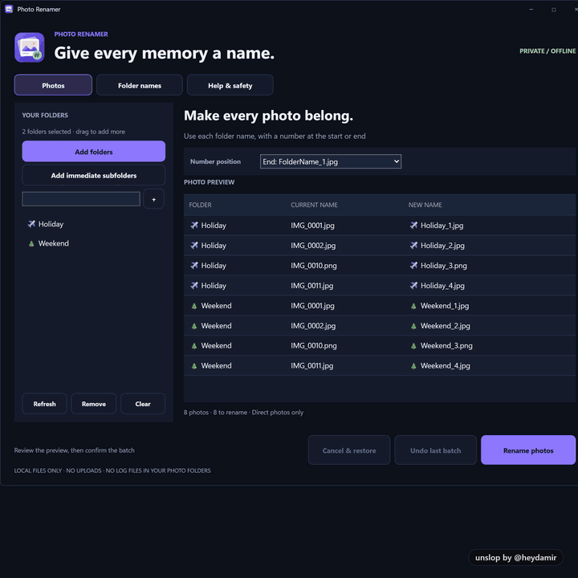
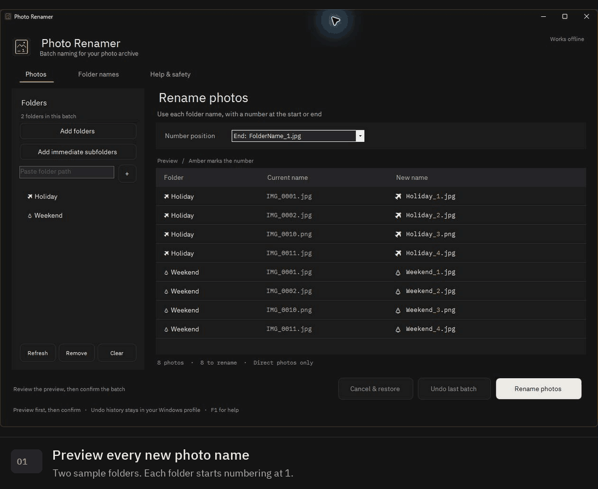
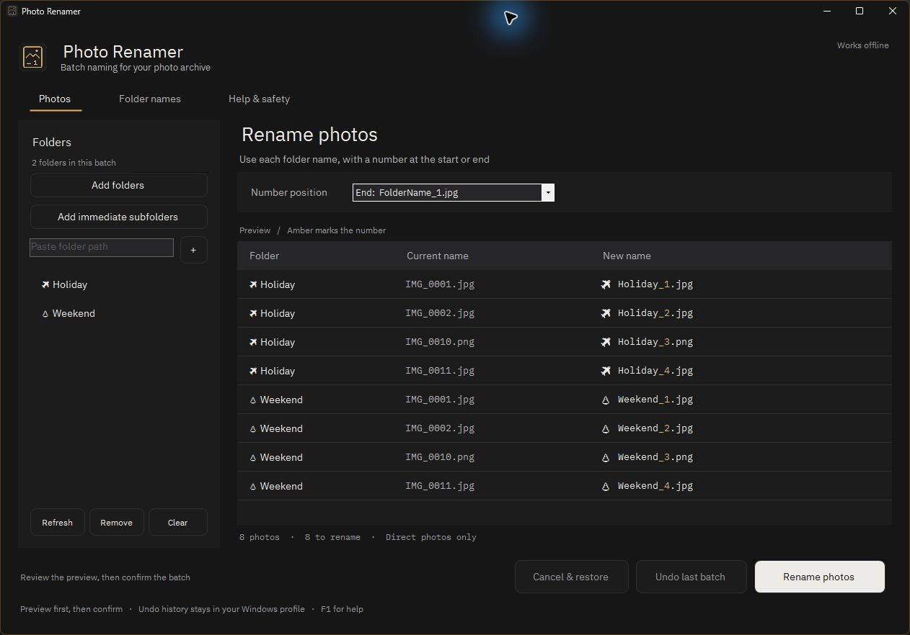
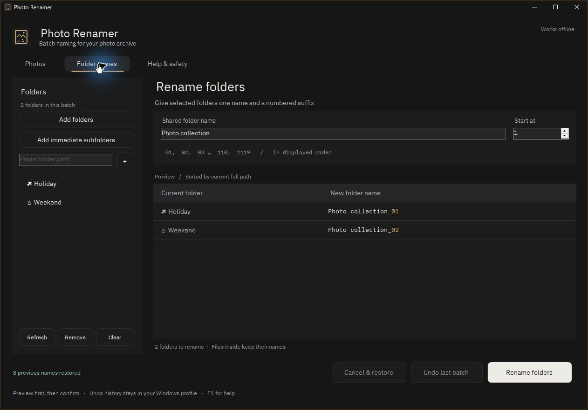
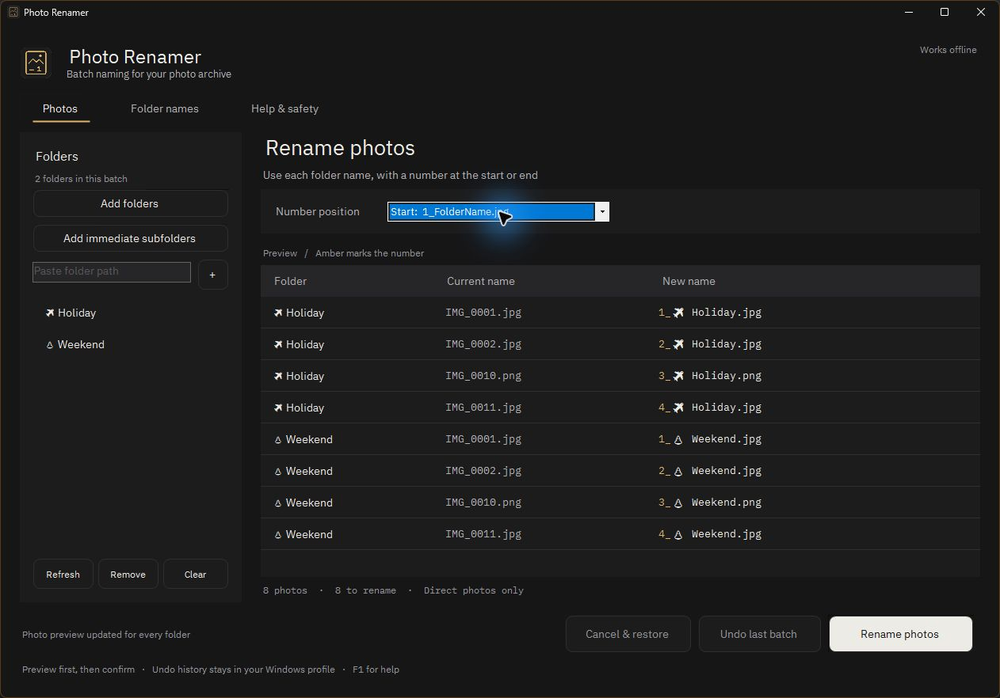
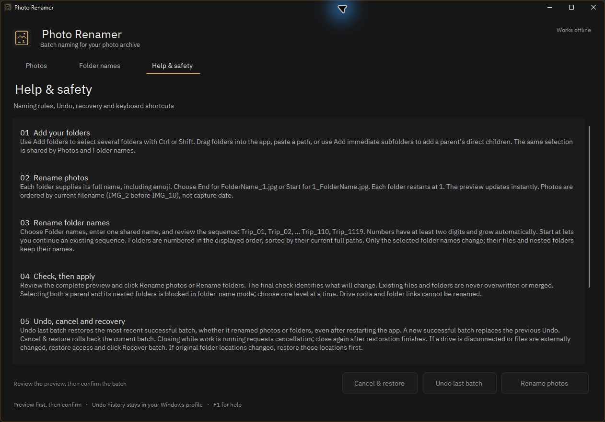

# Photo Renamer

**A small, offline Windows app for naming photo collections and folders.**

Rename photos from their containing folder's name, or give several folders a
shared name with numbered suffixes. Preview every change, keep emoji and file
extensions, and restore the most recent batch with Undo.

[Download the latest release](https://github.com/haldarsaurav/photo-renamer/releases/latest)
· [Report an issue](https://github.com/haldarsaurav/photo-renamer/issues)
· [Contribute](CONTRIBUTING.md)
· [MIT license](LICENSE)

## The v1.1 redesign

A graphite workspace, bundled IBM Plex typography, a flat photo-and-sequence
icon, and amber highlights on the number in each proposed name. The same
Photos, Folder names, Help, Undo and recovery tools remain available.

[](docs/images/redesign.mp4)

[Watch the redesign video](docs/images/redesign.mp4). This presentation
reconstructs the native interface in HTML and was rendered with the original
Unslop story tool. The actual app screenshots and working walkthrough follow
below. Read the [audit, direction and all nine design passes](docs/REDESIGN.md).

Design process: [Unslop](https://github.com/heydamir/unslop) by
**Damir Sokolovsky ([@heydamir](https://x.com/heydamir))**, CC BY 4.0.

## See it in action

Real app captures using generated sample photos: preview the names, switch the
number position, confirm a batch, rename, and restore the original names with
Undo. The walkthrough also shows folder naming and the built-in Help tab.



The animation uses real window captures with edited pauses and transitions.
For still images or a closer look, use the gallery below. Details about the
sample data and capture process are in [MEDIA.md](docs/MEDIA.md).

## Screenshots

| Photo-name preview | Shared folder-name preview |
| --- | --- |
| [](docs/images/photos.png) | [](docs/images/folders.png) |

<details>
<summary>Number-at-start preview and Help & safety</summary>

**Numbers at the start**



**Help & safety**



</details>

## Features

- **Photo names:** `Holiday_1.jpg` or `1_Holiday.jpg`; each folder restarts at 1.
- **Folder names:** `Holiday_01`, `Holiday_02`, and onward to `_110`, `_1119`
  and beyond, using one shared name and an optional starting number.
- **Multiple folders:** select with Ctrl/Shift, drag folders in, paste a path,
  or add the immediate children of selected parents.
- **Preview first:** changing the name or number position updates the preview.
- **Recovery tools:** batch Undo, cancellation with restoration, and recovery
  after an interrupted batch.
- **Dark workspace:** graphite surfaces, bundled IBM Plex fonts, highlighted
  number sequences, keyboard shortcuts, Help & safety, and a flat app icon.
- **Private by design:** no uploads, accounts, telemetry, or network connection
  required. No history or JSON files are placed in photo folders.

## Download and run

1. Open [Releases](https://github.com/haldarsaurav/photo-renamer/releases).
2. Download **Photo-Renamer.zip** from the release assets, then extract it.
3. Run **Photo Renamer.exe**. Keep **Photo Renamer.exe.config** beside it.

The executable is unsigned. Each release includes **SHA256SUMS.txt** so you can
compare the downloaded ZIP's checksum:

```powershell
Get-FileHash .\Photo-Renamer.zip -Algorithm SHA256
```

### Requirements

- Windows with **.NET Framework 4.7.2 or later**.
- Permission to rename the selected files or folders.
- No installer, administrator rights, subscription, or account is required.

macOS and Linux are not supported by this Windows Forms application.

## How to use it

### Add folders

Use **Add folders** to select several folders with Ctrl or Shift, drag folders
into the window, or paste a folder path and press Enter. You can also drop
folders onto the executable. **Add immediate subfolders** adds only the direct
children of selected parents; it does not recursively scan deeper levels.

The same selection is available in both naming tabs. Use **Refresh**,
**Remove**, and **Clear** to adjust it. Nothing is renamed until you confirm.

### Rename photos

Open **Photos** and choose the number position. For a folder named `✈️ Holiday`:

| Position | Example names |
| --- | --- |
| End | `✈️ Holiday_1.jpg`, `✈️ Holiday_2.heic` |
| Start | `1_✈️ Holiday.jpg`, `2_✈️ Holiday.heic` |

Each folder supplies its own complete name and starts its sequence at 1.
Photos follow natural current-filename order, so `IMG_2` comes before `IMG_10`.
The app does not sort by the date a photo was taken.

### Rename folders

Open **Folder names**, enter a **Shared folder name**, and optionally change
**Start at**. A shared name of `Photo collection` produces:

```text
Photo collection_01
Photo collection_02
Photo collection_03
...
Photo collection_110
Photo collection_1119
```

Numbers have at least two digits and grow automatically. Folders follow the
displayed order, sorted naturally by their current full paths. Each stays in
its existing parent directory. Files and nested folders inside keep their
names and contents. The app follows the selected folders after renaming them.

Select one directory level at a time: selecting both a parent and its nested
folders is blocked for folder naming. Drive roots and selected folder links
cannot be renamed.

## Safety, Undo and recovery

All selected items are checked before mutation. Stale photo previews,
missing or modified files, replaced directories, duplicate selections, and
occupied target names stop the batch. Files and folders are never overwritten
or merged. New plans check Windows volume and directory IDs to detect a
directory replaced at the same path.

- **Undo last batch** restores the most recent successful batch, whether it
  renamed photos or folders, including after restarting the app. A new
  successful batch replaces the previous Undo; a no-op or failed batch keeps it.
- **Cancel & restore** restores names changed by the running batch. A failure
  also attempts to restore the entire batch, including completed folders.
- **Recover batch** finishes restoration or saves a completed batch if the app
  was interrupted. Restore drive access and original parent locations first.
- Closing while work is running requests cancellation. Close again when
  restoration finishes.

Keep backups of valuable collections. **Undo stores names, not photo
contents.** Other applications, disconnected drives, moved parents, changed
permissions, or external edits can prevent immediate restoration. Recovery
records are retained until restoration or commit completes.

### Local history and privacy

The app uses folders you select; it has no hardcoded personal paths or albums.
Undo and recovery are stored under `%LOCALAPPDATA%\Photo Renamer` for the
current Windows account. These records remain local and are excluded from the
source repository and release.

Temporary file names or sibling temporary directories may appear while a batch
runs. Retain them if recovery is pending. Moving the executable to another
computer does not transfer Undo history.

## Supported photo formats and limits

JPG/JPEG, HEIC/HEIF, PNG, AVIF, WebP, GIF, BMP, TIFF, DNG and common camera RAW
formats are recognized by extension. Extension spelling and capitalization,
file contents, and modification times are preserved. Mixed formats share a
sequence within each folder.

Photo mode works on direct photos only. It skips nested folders, videos,
documents, sidecars and photo symlinks. Matching RAW/JPG/sidecar stems are not
grouped. Long paths also depend on Windows and the destination filesystem;
keep the supplied config next to the executable.

## Help and shortcuts

| Shortcut | Tab |
| --- | --- |
| F1 or Ctrl+3 | Help & safety |
| Ctrl+1 | Photos |
| Ctrl+2 | Folder names |
| Tab | Move between controls |

IBM Plex Sans and IBM Plex Mono are bundled in the executable and loaded
privately for the app. No fonts are installed into Windows or downloaded at
runtime. The font license is included with the download.

## Build from source

Use Windows, .NET Framework 4.7.2 or later, Git, and PowerShell. The build uses
the .NET Framework C# compiler from the Windows directory; no Visual Studio,
NuGet packages, or third-party runtime dependencies are required.

```powershell
git clone https://github.com/haldarsaurav/photo-renamer.git
cd photo-renamer
.\test.ps1
.\build.ps1
.\package.ps1 -SkipBuild
```

The executable, portable ZIP and checksum appear under **dist/**. To choose
another output directory:

```powershell
.\build.ps1 -OutputDirectory .\my-build
.\package.ps1 -OutputDirectory .\my-build -SkipBuild
```

## Tests and source layout

`test.ps1` runs **110 regression assertions** against generated data and
isolated test history. Coverage includes both photo number positions, emoji,
1,000-photo batches, folder suffixes beyond two digits, collisions, same-path
directory replacement, Undo, failure rollback and interrupted recovery.

```text
PhotoRenamer.Core.cs       Photo rename engine and shared history
FolderRenamer.cs           Folder naming, validation and recovery
PhotoRenamer.cs            Application UI and Help
DarkTheme.cs               Dark controls and native window styling
FolderPicker.cs            Windows multi-folder picker
CreateIcon.cs              Source for the embedded icon
*.Tests.cs                 Regression checks
tests/UiCheck.cs           Optional isolated desktop test harness
build.ps1 / package.ps1    Build and portable release packaging
verify-public.ps1          Check staged source for publication hygiene
```

Generated builds, sample directories, local history, and test logs are ignored
by Git. The [audit report](AUDIT.md) describes the focused review and its limits.
GitHub Actions runs the public-source check, tests, build and packaging on
Windows for pushes and pull requests. Automation actions are pinned to commit
IDs, with read-only repository permissions.

## Contributing and license

Everyone is welcome to use, modify and redistribute the application code,
including for commercial use, under the **[MIT license](LICENSE)**. Bundled
IBM Plex fonts use SIL OFL 1.1; the Unslop design process and story carry their
CC BY 4.0 credit. See [third-party notices](THIRD_PARTY_NOTICES.md),
[CONTRIBUTING.md](CONTRIBUTING.md) for development and reporting guidance and
[SECURITY.md](SECURITY.md) for private-data and security reporting guidance.
